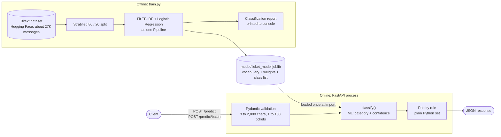

<div align="center">

# Support Ticket Classifier API

**Reads a customer support message and returns its category, priority and confidence in one API call.**


</div>

## The problem

Support teams receive hundreds of messages a day. Someone has to read each one, decide what it is about and decide how urgent it is before it reaches the right person. This API does that first pass automatically.

## What it does

```
POST /predict   {"text": "my payment failed twice"}
```
```json
{
  "text": "my payment failed twice",
  "category": "PAYMENT",
  "priority": "high",
  "confidence": 0.751
}
```

* **11 categories:** ACCOUNT, CANCEL, CONTACT, DELIVERY, FEEDBACK, INVOICE, ORDER, PAYMENT, REFUND, SHIPPING, SUBSCRIPTION
* **Priority rule:** PAYMENT, REFUND, CANCEL and ACCOUNT tickets are flagged `high`, everything else is `normal`
* **Batch mode:** send up to 100 tickets in one request

## System design

### Architecture



The model answers **what is this ticket about**. A separate business rule answers **how urgent is it**. Keeping those two questions apart is the central design choice.

### What happens on one request

1. Pydantic strips whitespace and rejects text shorter than 3 or longer than 2,000 characters, and batches outside 1 to 100 tickets, with a `422`.
2. `classify()` passes the raw string to the saved pipeline. TF-IDF turns it into a sparse vector of word and word pair weights, and Logistic Regression returns one probability per category.
3. The highest probability becomes the category, and that probability becomes `confidence`.
4. The category is looked up in `HIGH_PRIORITY`. PAYMENT, REFUND, CANCEL and ACCOUNT are `high`, everything else is `normal`.
5. Both endpoints go through the same `classify()` function, so single and batch requests can never disagree.

### Design decisions and trade offs

| Decision | Why | Cost |
|---|---|---|
| Priority is a rule in code, not a second model | The support team can change what counts as urgent in one line, with no retraining and no labelled priority data | The rule cannot learn that "where is my parcel, it's been 3 weeks" is urgent |
| TF-IDF + Logistic Regression instead of a transformer | Trains quickly on a laptop CPU, ships as a 575 KB file, needs no GPU to serve, and the weight of every word can be inspected | Misses meaning that is not in the words themselves, such as sarcasm and paraphrase |
| Vectorizer and classifier saved as **one** Pipeline | Serving cannot use a different vocabulary than training | Any change to text handling means retraining |
| Model loaded at **import time** | If the artifact is missing or broken the server refuses to start, so a bad deploy fails immediately and loudly | No hot reload; a new model needs a restart |
| Hard limits on text length and batch size | Caps the work one request can cause at 100 × 2,000 characters, which protects the service from very large payloads | Long emails must be cut before they are sent |

### Scaling

The process holds no state between requests, so it scales horizontally behind a load balancer. The endpoints are plain `def` functions, so FastAPI runs them in its thread pool. For one worker this is fine; for heavy traffic, run several Uvicorn workers or containers, because the CPU bound predictions hold Python's global interpreter lock.

### Known gaps

* **Batch is a loop.** `/predict/batch` calls the model once per ticket. Passing the whole list to a single `predict_proba` call would let scikit learn vectorize the work.
* **No abstain option.** Every ticket is routed automatically, even when confidence is low. A production version would send tickets below a confidence floor to a human queue.
* **Metrics are not saved.** `train.py` prints a classification report but does not write it next to the model, so the API cannot report which model version it runs or how good it is.
* **Training data is cleaner than reality.** The Bitext messages are generated from templates, so accuracy on real customer emails, with typos, several issues in one message and other languages, will be lower than on the test split.

### Model and data

| Step | Detail |
|:--|:--|
| Data | [Bitext customer support dataset](https://huggingface.co/datasets/bitext/Bitext-customer-support-llm-chatbot-training-dataset), about 27,000 labelled messages |
| Split | 80% train, 20% test, stratified by category |
| Features | TF-IDF on words and word pairs |
| Model | Logistic Regression, saved with joblib |
| Serving | FastAPI with Pydantic validation, model loaded once at startup |

## Endpoints

| Method | Path | Purpose |
|:--|:--|:--|
| GET | `/health` | Service check |
| POST | `/predict` | Classify one ticket |
| POST | `/predict/batch` | Classify 1 to 100 tickets |

Input text must be 3 to 2000 characters. Empty, whitespace only, oversized or missing input returns `422`.

Interactive docs are at `http://localhost:8000/docs` once the server is running.

## Run it

```bash
git clone https://github.com/sidhantds/ticket-classifier-api.git
cd ticket-classifier-api
pip install -r requirements.txt
uvicorn app.main:app --reload
```

Retrain the model (downloads the dataset and prints a full classification report):

```bash
python train.py
```

Run the tests:

```bash
pytest
```

## Tests

12 tests cover the happy path (health check, response shape, PAYMENT and CANCEL routed as high priority, batch size) and validation (short, blank, too long, missing and oversized batch input all rejected).

## Project structure

```
ticket-classifier-api/
├── app/main.py              # API, validation, priority rule
├── model/ticket_model.joblib
├── tests/test_api.py
├── train.py                 # training and evaluation
└── requirements.txt
```

---

<div align="center">

Built by [Sidhant Pujara](https://sidhantpujara.vercel.app/)

</div>
